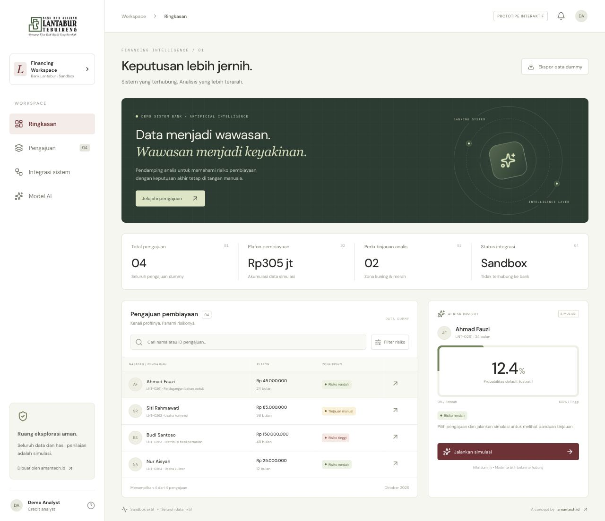

# bank-lantabur

Prototipe interaktif **Lantabur AI Financing**, dibuat oleh [amantech.id](https://amantech.id/) untuk memvisualisasikan integrasi sistem bank dengan AI credit scoring.



## Menjalankan

Gunakan Node.js 22 atau lebih baru dan npm.

```bash
npm ci
npm run dev
```

Buka http://127.0.0.1:3000/. Dashboard tersedia langsung di halaman utama.

```bash
npm run typecheck
npm run build
```

Konfigurasi memakai static export Next.js. Hasil build ada di `out/`, siap disajikan melalui static hosting. Untuk preview hasil build:

```bash
python3 -m http.server 3000 --bind 127.0.0.1 --directory out
```

## Fitur

- Ringkasan pengajuan dan plafon pembiayaan.
- Pencarian dan filter risiko pengajuan.
- Pemilihan nasabah dan simulasi tiga zona risiko.
- Visualisasi alur integrasi serta sinkronisasi data dummy.
- Ringkasan konsep model AI dan ekspor CSV dummy.
- Tampilan responsif dan dukungan reduced motion.

## Batasan demo

Seluruh nama, pengajuan, nominal, dan probabilitas merupakan fixture fiktif. Tidak ada koneksi ke sistem bank, database nasabah, API inferensi, atau model terlatih. Tidak ada keputusan pembiayaan nyata.

Konsep mengacu pada notebook credit scoring BPRS yang diberikan pemilik proyek: preprocessing, perbandingan delapan model, dan zona risiko <20%, 20–55%, >55%. Notebook, dataset, dan artefak model tidak disertakan dalam repository ini.

## Stack dan aset

Next.js, React, TypeScript, Lucide React, dan CSS. Logo Lantabur bersumber dari [situs resmi BPRS Lantabur](https://bprslantabur.id/wp-content/uploads/2022/11/Logo-LTI-Horizontal-1.png). Hak merek tetap milik pemiliknya. Ini adalah prototipe visual oleh amantech.id.
